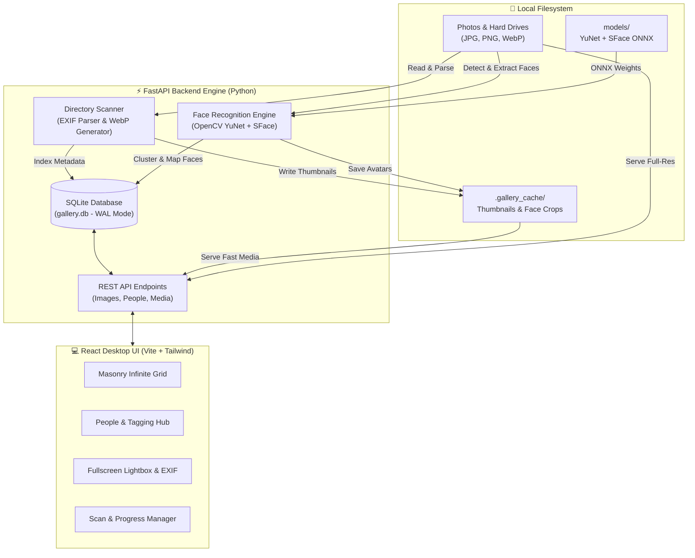

<div align="center">

# 🖼️ PC Gallery

### Local AI-Powered Photo Gallery with Facial Recognition & EXIF Indexing

[](LICENSE)
[](https://www.python.org/)
[](https://fastapi.tiangolo.com/)
[](https://react.dev/)
[](https://vitejs.dev/)
[](https://tailwindcss.com/)
[](https://opencv.org/)

<p align="center">
  <b>PC Gallery</b> is an ultra-fast, 100% private, locally hosted photo gallery for your PC. It scans your local folders, extracts rich EXIF camera metadata, generates lightweight WebP thumbnails, and utilizes on-device deep learning models (<b>YuNet</b> and <b>SFace</b>) to detect and cluster people automatically — with <b>zero cloud dependencies</b>.
</p>

[Key Features](#-key-features) •
[Architecture](#-system-architecture) •
[Quick Start](#-quick-start-windows) •
[Tech Stack](#-technology-stack) •
[API Documentation](#-api-documentation) •
[Roadmap](#-roadmap)

---

</div>

## 🌟 Overview

Most modern photo galleries require uploading your private memories to cloud platforms or third-party servers. **PC Gallery** brings the power of smart cloud photo services (like Google Photos or Apple Photos) directly to your local computer:

- **100% Offline & Private**: None of your photos, metadata, or face embeddings ever leave your device.
- **Lightweight Deep Learning**: Uses high-performance ONNX models (~230 KB YuNet detector + ~37 MB SFace recognizer) that run smoothly on standard consumer CPUs without requiring dedicated GPUs.
- **Blazing Fast Browsing**: Generates compressed WebP thumbnails on first scan, enabling buttery-smooth virtualized infinite scrolling even across thousands of photos.

---

## ✨ Key Features

### 1. 🤖 On-Device AI Facial Recognition & Clustering
- **Face Detection (YuNet)**: Real-time, ultra-compact deep neural network face detector.
- **Face Embeddings (SFace)**: Extracts 128-dimensional biometric facial feature vectors.
- **Smart Clustering Engine**: Automatically groups similar faces across your entire library using cosine similarity and nearest-neighbor clustering.
- **Face Crops & Avatars**: Generates high-quality cropped face avatars for recognized individuals.
- **People Profiles**: View all detected people, browse photos filtered by person, and rename individuals (e.g., `Person 1` -> `Alice`).

### 2. ⚡ High-Speed Directory Scanner & Thumbnail Engine
- **Multithreaded Scanning**: Recursively scans any local folder or drive path without blocking the UI.
- **EXIF Metadata Extraction**: Automatically parses camera manufacturer, lens model, ISO, aperture, shutter speed, focal length, creation timestamps, and dimensions.
- **Optimized WebP Caching**: Generates lightweight WebP thumbnails stored in `.gallery_cache`, keeping initial render times near-instantaneous.
- **Incremental Rescanning**: Detects new and modified files, skipping unchanged photos.

### 3. 🖥️ Modern Desktop-Class User Experience
- **Responsive Masonry Grid**: Dynamic multi-column layout with progressive image loading.
- **Infinite Virtualized Scrolling**: Smooth performance even with libraries containing tens of thousands of items.
- **Fullscreen Lightbox Modal**: View original high-resolution photos with keyboard navigation (`Left`/`Right` arrows, `Esc` to close).
- **EXIF Inspector Panel**: Toggleable metadata sidebar showing full photographic details and recognized face tags.
- **Local Scanner Modal**: Simple dialog to enter any local path (e.g., `D:\Photos\2024`) and monitor real-time scanning progress.

### 4. 🗄️ High-Concurrency SQLite Engine
- Configured with **Write-Ahead Logging (WAL)** mode and Foreign Key enforcement.
- Fast indexed queries for paginated listing, date sorting, and person-specific filtering.

### 5. 🚀 One-Click Windows Automation
- **`setup.bat`**: Automatic environment verification (Python 3.10+ & Node.js), dependency installation, AI model downloads, and production frontend build.
- **`run.bat`**: Single-click launcher that boots the FastAPI server on `http://localhost:8000` and automatically opens your default browser.
- **`run_dev.bat`**: Developer launcher running backend and Vite hot-reloading frontend concurrently.

---

## 🏗️ System Architecture



---

## 🛠️ Technology Stack

| Layer | Technology | Purpose |
| :--- | :--- | :--- |
| **Backend Framework** | FastAPI (Python 3.10+) | High-performance asynchronous REST API |
| **Database** | SQLite + SQLAlchemy ORM | Local indexing with WAL mode and foreign key constraints |
| **Image Processing** | Pillow (PIL) & OpenCV | EXIF extraction, thumbnail compression, and image decoding |
| **AI Vision Models** | OpenCV YuNet & SFace (ONNX) | Lightweight on-device face detection and 128-d face recognition |
| **Frontend Framework** | React 18 + Vite | Modular, ultra-responsive single-page application |
| **Styling & UI** | Tailwind CSS + Lucide Icons | Clean modern desktop design with smooth transitions |
| **Automation** | Windows Batch Scripts | One-click setup, build, and execution scripts |

---

## 🚀 Quick Start (Windows)

### 1. Automated Setup (First Time)
Double-click `setup.bat` or run:
```cmd
setup.bat
```
This automated script will:
1. Check that **Python 3.10+** and **Node.js** are installed.
2. Create data and cache directories (`backend/data/.gallery_cache`).
3. Install Python dependencies (`fastapi`, `uvicorn`, `opencv-python`, `pillow`, `sqlalchemy`, etc.).
4. Download the AI facial recognition ONNX models automatically from HuggingFace.
5. Install frontend NPM packages and compile the production build into `frontend/dist`.
6. Initialize the SQLite database.

---

### 2. Launch the Application
Double-click `run.bat` or run:
```cmd
run.bat
```
- Starts the unified server on `http://localhost:8000`.
- Automatically opens your default web browser.
- Interactive API documentation is available at `http://localhost:8000/docs`.

---

### 3. Developer Mode (Hot-Reloading)
To work on code with hot-reloading:
```cmd
run_dev.bat
```
- Backend runs on `http://localhost:8000` with auto-reload.
- Frontend runs on `http://localhost:5173` with Vite HMR.

---

## 🐧 Cross-Platform Setup (Linux / macOS)

```bash
# 1. Clone the repository
git clone https://github.com/dhruvil-114/pc-gallery.git
cd pc-gallery

# 2. Setup Python virtual environment
python3 -m venv .venv
source .venv/bin/activate
pip install -r backend/requirements.txt

# 3. Download AI facial recognition models
python3 backend/app/download_models.py

# 4. Build frontend
cd frontend
npm install
npm run build
cd ..

# 5. Initialize database & run
python3 -c "import sys; sys.path.insert(0, 'backend'); from app.database import init_db; init_db()"
export PYTHONPATH=backend
uvicorn app.main:app --host 127.0.0.1 --port 8000
```

---

## 📂 Project Structure

```text
pc_gallery/
├── setup.bat                 # One-click automated installer for Windows
├── run.bat                   # One-click launcher (starts server & opens browser)
├── run_dev.bat               # Developer mode (FastAPI reload + Vite dev server)
├── run_gallery.bat           # Quick launcher shortcut
├── .coderabbit.yaml          # Code quality and review configuration
├── .gitignore                # Git exclusions (caches, DBs, models, node_modules)
├── CONTRIBUTING.md           # Open-source contribution guidelines
├── LICENSE                   # MIT Open Source License
├── README.md                 # Project documentation
├── backend/
│   ├── requirements.txt      # Python dependencies
│   ├── app/
│   │   ├── main.py           # FastAPI app, static mounts & REST endpoints
│   │   ├── database.py       # SQLAlchemy engine, WAL pragmas & session factory
│   │   ├── models.py         # Database models (Image, Person, FaceMap)
│   │   ├── schemas.py        # Pydantic validation schemas (V2)
│   │   ├── crud.py           # Database CRUD queries
│   │   ├── scanner.py        # Multithreaded folder scanner & WebP generator
│   │   ├── face_engine.py    # AI facial detection & clustering worker
│   │   └── download_models.py# Automatic ONNX models downloader
│   └── tests/                # Automated backend unit tests
└── frontend/
    ├── package.json          # Frontend packages & scripts
    ├── vite.config.js        # Vite configuration & backend proxy
    ├── tailwind.config.js    # Tailwind styling config
    └── src/
        ├── App.jsx           # Master gallery controller
        ├── api.js            # Axios/Fetch API client
        └── components/
            ├── ImageCard.jsx     # Photo thumbnail with progressive rendering
            ├── ImageGrid.jsx     # Responsive infinite masonry grid
            ├── PeopleGrid.jsx    # Recognized people cards & renaming dialog
            ├── LightboxModal.jsx # Fullscreen modal with EXIF & face tags
            ├── ScanModal.jsx     # Folder scanner dialog with progress tracking
            └── Sidebar.jsx       # Navigation sidebar & AI quick trigger
```

---

## 📑 API Documentation

Once the server is running, visit **`http://localhost:8000/docs`** to access the interactive Swagger UI. Key endpoints include:

- `POST /api/scan/start` - Initiate directory scanning on a target path.
- `GET /api/scan/status` - Poll real-time scanner progress.
- `GET /api/images` - Paginated photo library sorted by date taken.
- `GET /api/images/{id}` - Full metadata and recognized people for a photo.
- `GET /thumbnail/{id}` - Optimized WebP thumbnail.
- `GET /image/{id}` - Original high-resolution photo file.
- `POST /api/faces/cluster` - Trigger on-demand facial clustering across scanned images.
- `GET /api/people` - List recognized people with photo counts and avatars.
- `PATCH /api/people/{id}` - Update a person's display name.

---

## 🛡️ Privacy & Security

- **Zero Cloud Communication**: The application makes no outgoing network requests during normal operation (except for downloading open-source ONNX weights during initial setup).
- **Safe from Version Control**: `.gitignore` is strictly configured to prevent databases (`gallery.db`), thumbnail caches, and personal media files from ever being committed.
- **Local Sandbox**: The server binds exclusively to `127.0.0.1` by default, ensuring your gallery is not exposed to the local network unless explicitly configured.

---

## 🗺️ Roadmap

- [x] Multithreaded directory scanning with EXIF extraction
- [x] WebP thumbnail generation and caching
- [x] On-device AI facial detection & clustering (YuNet + SFace)
- [x] People albums with name editing
- [x] Responsive desktop web interface with Lightbox
- [ ] 🔍 Semantic natural language search (CLIP on-device embeddings)
- [ ] 🗺️ Interactive world map view for GPS geotagged photos
- [ ] 🎞️ Video indexing and thumbnail preview support
- [ ] 🗓️ Timeline calendar scrubber and date range filters
- [ ] 📦 One-click portable desktop installer (Electron / Tauri packaging)

---

## 🤝 Contributing

Contributions are welcomed! Feel free to report issues, suggest ideas, or submit pull requests.  
Please see [CONTRIBUTING.md](CONTRIBUTING.md) for detailed guidelines.

---

## 📜 License

This project is licensed under the **MIT License** - see the [LICENSE](LICENSE) file for details.

---

## 👨‍💻 Author

**Dhruvil Panchal**
- GitHub: [@dhruvil-114](https://github.com/dhruvil-114)

---

<div align="center">
  <sub>Built with ❤️ for private, blazingly fast personal photo management.</sub>
</div>
